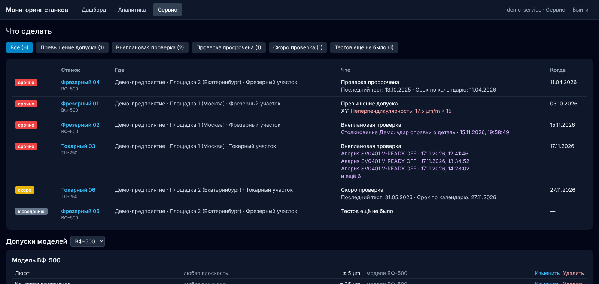
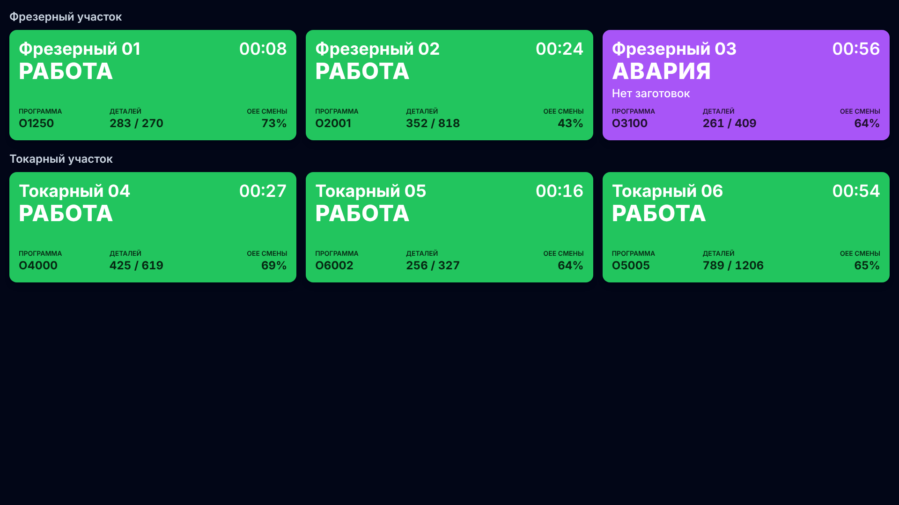
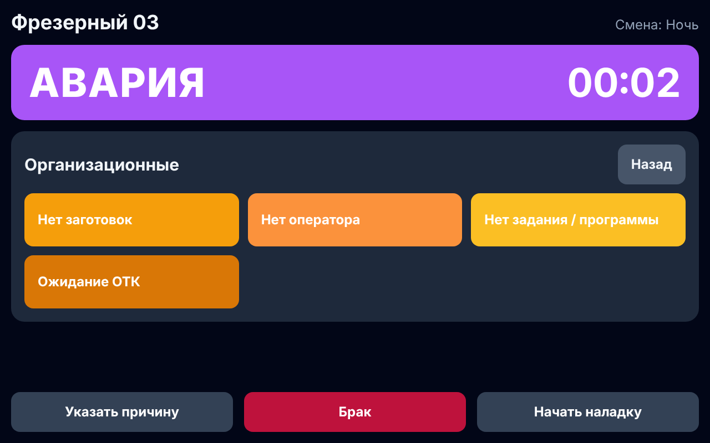

# iot_fanuc — мониторинг станков с ЧПУ

Платформа мониторинга станков (Fanuc 0i-MD и др.) и расчёта OEE — сервис для многих
предприятий-клиентов: одна установка, данные клиентов разделены по организациям, сотрудники
сервисной компании видят станки всех клиентов. Сейчас работает сквозной каркас на симуляторе.

- Архитектура и этапы: [ARCHITECTURE.md](ARCHITECTURE.md)
- Правила разработки: [CLAUDE.md](CLAUDE.md)
- Что сделано в каркасе, что упрощено: [docs/skeleton-report.md](docs/skeleton-report.md)
- Укрепление ядра данных: [docs/harden-core-report.md](docs/harden-core-report.md)
- Организации, площадки и роли: [docs/tenancy-roles-report.md](docs/tenancy-roles-report.md)
- Геометрическая точность (ballbar): [docs/geometry-report.md](docs/geometry-report.md)
- Текущий план работ: [NOW.md](NOW.md)
- Быстрый старт и команды: [docs/runbooks/dev-quickstart.md](docs/runbooks/dev-quickstart.md)

## Запуск

Нужны Docker с Compose v2 и `make`.

```bash
make up
```

Команда создаёт `.env` из `.env.example`, собирает образы и поднимает брокер, БД, Redis,
`ingest`, `worker`, `api`, `web` и два симулятора — по одному на каждую площадку демо-организации
(«Площадка 1 (Москва)» — 3 станка, «Площадка 2 (Екатеринбург)» — 3 станка). При первом старте
симулятор досылает историю за последние 8 часов, поэтому через полминуты экраны уже заполнены.

## Вход и экраны

Интерфейс открывается на <http://localhost:8080> (порт — `MM_WEB_PORT` в `.env`). Каждый входит
под своей учётной записью и видит только то, что разрешено его ролью.

| Учётная запись | Пароль | Роль | Что видит |
|---|---|---|---|
| `admin` | `admin` | суперадмин | всё; создаёт организации |
| `demo-admin` | `demo` | администратор организации | обе площадки; станки, справочники, пользователи, токены киосков |
| `demo-engineer` | `demo` | технолог площадки 1 | станки площадки 1, аналитика, нормы цикла |
| `demo-master` | `demo` | мастер фрезерного участка площадки 1 | станки своего участка, аналитика, правка причин |
| `demo-operator` | `demo` | оператор того же участка | дашборд и экран оператора |
| `demo-service` | `demo` | сервисный инженер | станки всех организаций; тесты ballbar, допуски, экран «Сервис» |

Учётные записи `demo-*` и демо-токены создаются только при `MM_DEMO_DATA=true` (так в
`.env.example`). Пароль суперадмина задаётся `MM_ADMIN_USERNAME` / `MM_ADMIN_PASSWORD`.

Киоски входят по ссылке с токеном устройства, без пароля:

| Экран | Ссылка |
|---|---|
| Экран оператора станка «Фрезерный 02» | `http://localhost:8080/operator/2?token=dev_demo-kiosk-sim02` |
| ТВ-дашборд фрезерного участка площадки 1 | `http://localhost:8080/dashboard/1?token=dev_demo-display-area1` |

Токен киоска открывает только свой станок или свой участок. Новые токены выдаёт и отзывает
администратор в «Админка → Токены киосков»; ссылка показывается один раз, в базе хранится только хеш.

## Геометрическая точность

Тесты Renishaw QC20 (Ballbar 20) ведутся в карточке станка `http://localhost:8080/machines/<id>`
(ссылка — из «Сервиса» или из таблицы в «Аналитике»): ввод результатов по отчёту, загрузка оригиналов
`.b5r` и PDF, полярный график, тренд, допуски, срок следующей проверки. Экран «Сервис»
(`http://localhost:8080/service`) собирает превышения допусков и проверки, которые пора делать.
В демо-режиме у станков есть выдуманные тесты; войдите как `demo-service`.

Автоматический разбор `.b5r` пока не сделан: образцы для него кладутся в
`backend/tests/fixtures/ballbar/` (формат — в README там).



Что попробовать:

- на дашборде нажать плитку станка — откроется экран оператора;
- дождаться простоя на «Фрезерном 02» (красный «Простой») — экран оператора сам спросит причину,
  выбор занимает два касания;
- войти как `demo-master` и `demo-engineer` — сравнить, какие станки видит каждый;
- под `demo-admin` создать пользователя и выдать ему роль на участок;
- под `demo-service` открыть «Сервис», перейти в карточку «Фрезерного 01» и ввести новый тест;
- в аналитике переключить «Текущая смена / Предыдущая смена / Сегодня / Вчера»;
- в админке изменить норму цикла — пересчёт запустится сам.






## Команды

```bash
make test
```

```bash
make lint
```

```bash
make recalc from=2026-11-16T05:00:00Z
```

Остальные команды (`logs`, `ps`, `down`, `clean`, `psql`, `migrate`) — в runbook.

## Проверка реальной стойки

Проба FOCAS (этап 0) **на реальной стойке не проверена**:

```bash
python edge/tools/focas_probe.py --ip 192.168.10.57 --port 8193 --lib edge/vendor/Fwlib64.dll --watch
```
