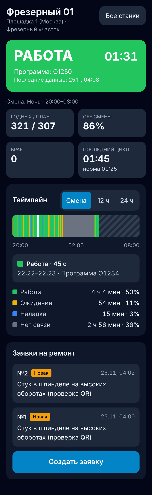
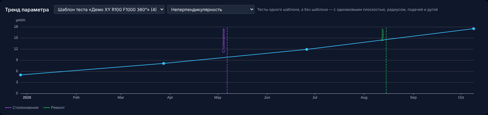
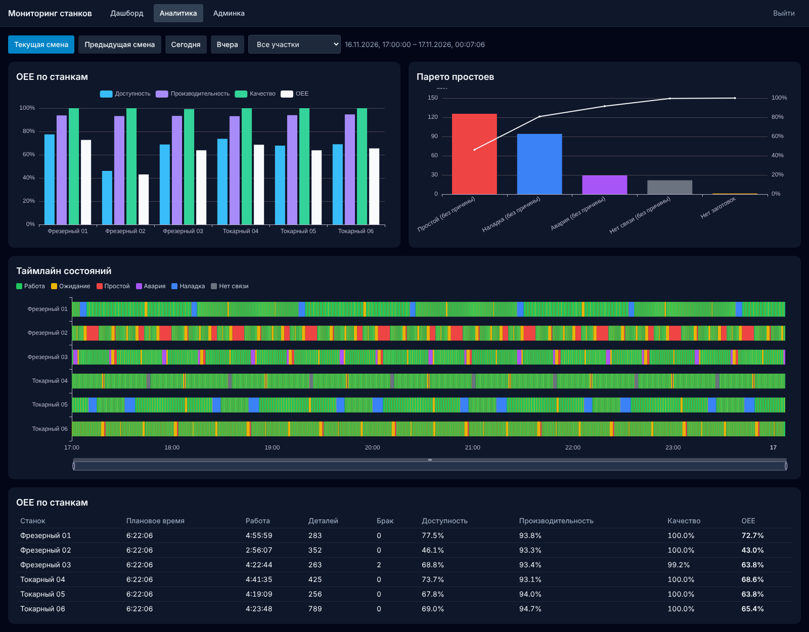
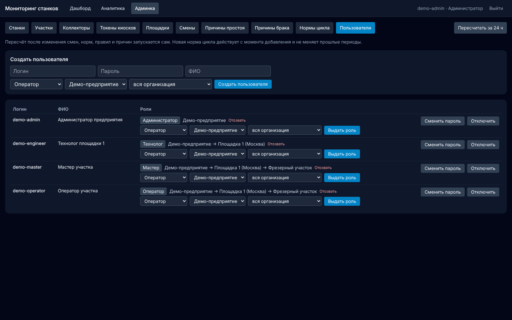

# iot_fanuc — мониторинг станков с ЧПУ

[](https://github.com/kanapello/iot_fanuc/actions/workflows/ci.yml)

Платформа мониторинга станков (Fanuc 0i-MD и др.) и расчёта OEE — сервис для многих
предприятий-клиентов: одна установка, данные клиентов разделены по организациям, сотрудники
сервисной компании видят станки всех клиентов. Версия 0.4.0: вся цепочка работает на симуляторе;
на реальной стойке проба FOCAS ждёт проверки после исправления загрузки DLL.

- Архитектура и этапы: [ARCHITECTURE.md](ARCHITECTURE.md)
- Что сейчас и что ждёт решения: [NOW.md](NOW.md); изменения по версиям: [CHANGELOG.md](CHANGELOG.md)
- Правила разработки: [CLAUDE.md](CLAUDE.md)
- Что сделано в каркасе, что упрощено: [docs/skeleton-report.md](docs/skeleton-report.md)
- Укрепление ядра данных: [docs/harden-core-report.md](docs/harden-core-report.md)
- Организации, площадки и роли: [docs/tenancy-roles-report.md](docs/tenancy-roles-report.md)
- Геометрическая точность — архив сервиса: [docs/geometry-report.md](docs/geometry-report.md)
- Ремонт и обслуживание: [docs/service-repairs-report.md](docs/service-repairs-report.md)
- Быстрый старт и команды: [docs/runbooks/dev-quickstart.md](docs/runbooks/dev-quickstart.md)

## Запуск

Нужны Docker с Compose v2 и `make`.

```bash
make up
```

Команда создаёт `.env` из `.env.example`, собирает образы и поднимает брокер, БД, Redis,
`ingest`, `worker`, `api`, `web` и два симулятора — по одному на каждую площадку демо-организации
(«Площадка 1 (Москва)» — 3 станка, «Площадка 2 (Екатеринбург)» — 3 станка). При первом старте
симулятор досылает историю за последние 8 часов, поэтому через полминуты экраны уже заполнены.

Для облачной VM в интернете (HTTPS по домену, MQTT по TLS, бэкапы в S3) — `make env-prod domain=… email=…`
и `make prod-up`, по шагам — [docs/runbooks/cloud-install.md](docs/runbooks/cloud-install.md) (ADR 0010).

## Вход и экраны

Интерфейс открывается на <http://localhost:8080> (порт — `MM_WEB_PORT` в `.env`). Каждый входит
под своей учётной записью и видит только то, что разрешено его ролью.

| Учётная запись | Пароль | Роль | Что видит |
|---|---|---|---|
| `admin` | `admin` | суперадмин | всё; создаёт организации |
| `demo-admin` | `demo` | администратор организации | обе площадки; станки, справочники, пользователи, токены киосков; аварии, заявки на ремонт, график ТО |
| `demo-engineer` | `demo` | технолог площадки 1 | станки площадки 1, аналитика, нормы цикла, аварии, заявки на ремонт |
| `demo-master` | `demo` | мастер фрезерного участка площадки 1 | станки своего участка, аналитика, правка причин, заявки на ремонт |
| `demo-operator` | `demo` | оператор того же участка | дашборд и экран оператора |
| `demo-service` | `demo` | сервисный инженер | станки всех организаций; ведёт заявки на ремонт и ТО; архив геометрии (экран «Сервис») |

Учётные записи `demo-*` и демо-токены создаются только при `MM_DEMO_DATA=true` (так в
`.env.example`). Пароль суперадмина задаётся `MM_ADMIN_USERNAME` / `MM_ADMIN_PASSWORD`.

Киоски входят по ссылке с токеном устройства, без пароля:

| Экран | Ссылка |
|---|---|
| Экран оператора станка «Фрезерный 02» | `http://localhost:8080/operator/2?token=dev_demo-kiosk-sim02` |
| ТВ-дашборд фрезерного участка площадки 1 | `http://localhost:8080/dashboard/1?token=dev_demo-display-area1` |

Токен киоска открывает только свой станок или свой участок. Новые токены выдаёт и отзывает
администратор в «Админка → Токены киосков»; ссылка показывается один раз, в базе хранится только хеш.

## Ремонт и обслуживание

«Аварии» (`/alarms`) — журнал аварий: частота по станкам, эпизоды с длительностью, телеметрия за
10 минут до аварии и кнопка «Создать заявку». «Ремонт и ТО» (`/repairs`) — заявки на ремонт со
статусами «новая → принята → в работе → выполнена», исполнителем из сервиса, временем реакции и
восстановления по таймлайну, и график обслуживания по наработке. Клиент видит свои заявки и график,
ведёт их сервис; на экране «Сервис» — напоминания по ТО и открытые заявки. Подробности — ADR 0006.

## QR-паспорт станка

На каждый станок — наклейка с QR-кодом: ссылка `http://localhost:8080/m/<код>` и ничего больше. Наклейку
и лист наклеек участка (A4, по 10 штук) печатает администратор в «Админка → Станки» и «Админка → Участки»;
там же «Новый код» — старая наклейка сразу перестаёт открываться. По ссылке с телефона: без входа — форма
входа и возврат; мастер, технолог и администратор видят состояние, таймлайн и создают заявку в два касания;
сервис попадает в карточку станка, оператор — на экран оператора; чужой станок и неверный код — одинаковое
«нет доступа». В продакшене задайте `MM_PUBLIC_URL` — адрес, по которому интерфейс открывают люди
(например, `https://mm.example.com`), иначе на наклейку попадёт адрес, по которому зашёл администратор.
Подробности — ADR 0009.

 

## Уведомления в Telegram

Бот присылает события в личный чат: аварии станков и их снятие, предупреждения батареи и вентилятора стойки,
коллектор без связи, простой без причины, заявки на ремонт и их статусы, подходящее ТО — каждому по его роли и
только по его станкам. Подключение — «Профиль» (имя в правом верхнем углу) → «Подключить Telegram»; там же типы
событий. Бот работает без публичного адреса сервера (long polling): нужны `MM_TELEGRAM_BOT_TOKEN` и
`MM_TELEGRAM_BOT_USERNAME` в `.env` — runbook установки, раздел 4; подробности — ADR 0011.

## Геометрическая точность

Внутренний архив сервиса — его видят только сервисные инженеры (`demo-service`) и суперадмин.
Экран «Сервис» (`http://localhost:8080/service`) — список станков с датой последнего теста Renishaw
QC20 (Ballbar 20). В карточке станка — тесты с ручным вводом результатов, оригиналы `.b5r` и PDF
(хранятся всегда), полярный график при наличии точек, тренд параметра с отметками «столкновение»
и ремонтами. Анализа (допусков, сроков проверок) нет. Отметку «столкновение» ставят оператор и
мастер с экрана оператора.



Что попробовать:

- на дашборде нажать плитку станка — откроется экран оператора;
- дождаться простоя на «Фрезерном 02» (красный «Простой») — экран оператора сам спросит причину,
  выбор занимает два касания;
- войти как `demo-master` и `demo-engineer` — сравнить, какие станки видит каждый;
- под `demo-admin` создать пользователя и выдать ему роль на участок;
- под `demo-service` открыть «Сервис», перейти в карточку «Фрезерного 01», посмотреть тренд и ввести новый тест;
- под `demo-admin` открыть «Аварии», раскрыть телеметрию аварии «Токарного 03» и создать заявку;
  под `demo-service` принять её с исполнителем, начать и выполнить — ремонт появится в журнале станка;
- в аналитике переключить «Текущая смена / Предыдущая смена / Сегодня / Вчера»;
- в админке изменить норму цикла — пересчёт запустится сам;
- под `demo-admin` скачать наклейку «Фрезерного 01» в «Админка → Станки» и открыть ссылку из неё на телефоне
  (или в узком окне) под `demo-master`, `demo-service` и `demo-operator`.






## Команды

```bash
make test
```

То же на GitHub Actions (`.github/workflows/ci.yml`) для каждого pull request и `main`: backend (ruff,
mypy, pytest на PostgreSQL + TimescaleDB и Mosquitto в testcontainers), edge (ruff, mypy, pytest),
frontend (сборка), сборка Docker-образов `backend`, `web`, `edge`. В `main` сливается только pull request
с зелёными проверками.

```bash
make lint
```

```bash
make recalc from=2026-11-16T05:00:00Z
```

Остальные команды (`logs`, `ps`, `down`, `clean`, `psql`, `migrate`) — в runbook.

## Проверка реальной стойки

Проба FOCAS только читает. Без флагов и с `--watch` (раз в секунду) — минимум: модель ЧПУ, серия и версия
ПО, оси (один раз), статус, номер и имя программы, счётчик деталей, аварии — с временем ответа каждого
вызова:

```bash
python edge/tools/focas_probe.py --ip 192.168.10.57 --port 8193 --lib edge/vendor/Fwlib64.dll --watch --out probe.txt
```

`--recon` — один проход расширенного набора (коррекции из PMC, инструмент, таймеры, нагрузки осей,
`cnc_rddynamic2`, подача, обороты, нагрузка шпинделя; по запросу `--pmc` и `--diag`). Порядок у станка —
[docs/runbooks/first-machine.md](docs/runbooks/first-machine.md). `--out` дописывает весь вывод в файл
(UTF-8). Fwlib64.dll при подключении сама грузит `fwlibe64.dll` и `fwlib0iD64.dll` по имени, поэтому
проба и коллектор ставят папку библиотеки первой в `PATH` процесса. Все DLL Fanuc — в одной папке.

Если стойка не отвечает — [docs/runbooks/collector-network.md](docs/runbooks/collector-network.md): где
ставить коллектор, почему на его ПК не должно быть VPN, проверка пути через `Find-NetRoute` и порядок
проверки: `ping`, `Test-NetConnection`, проба.
