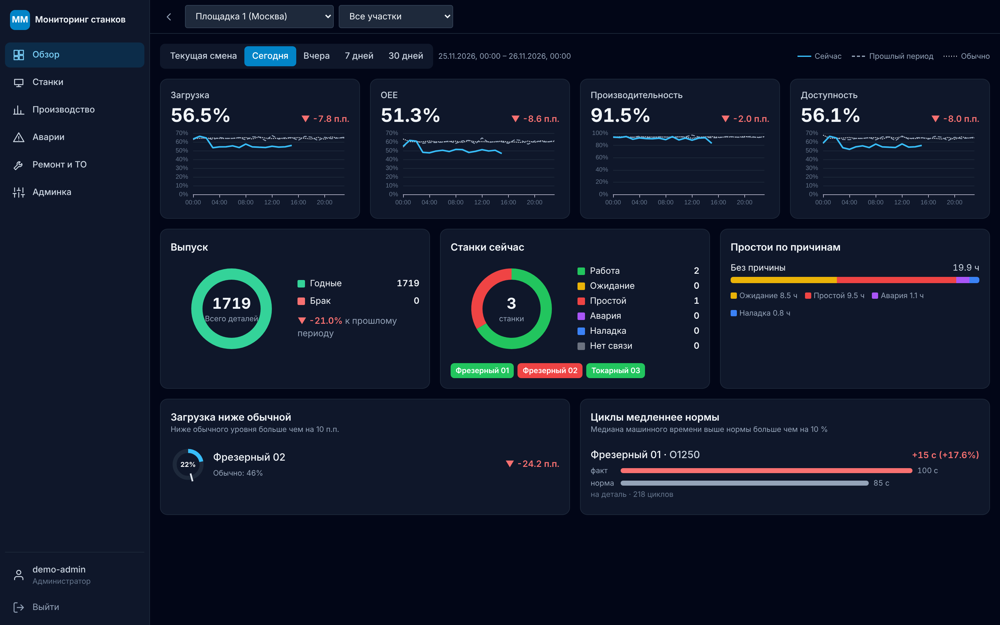
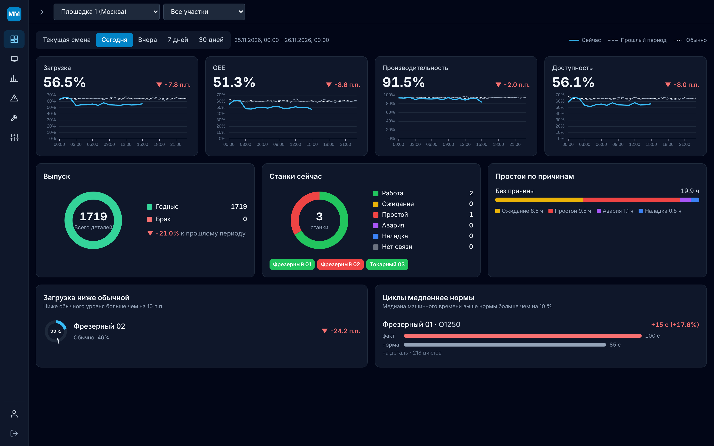
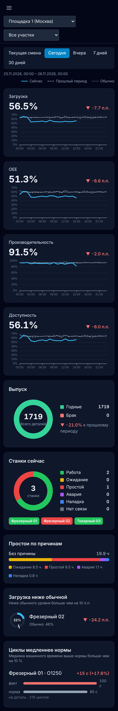
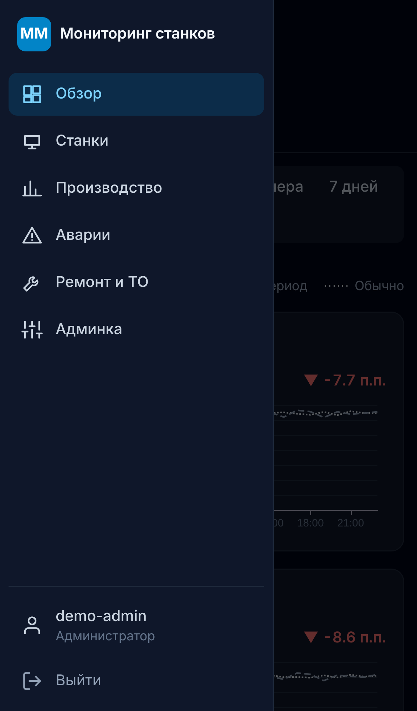
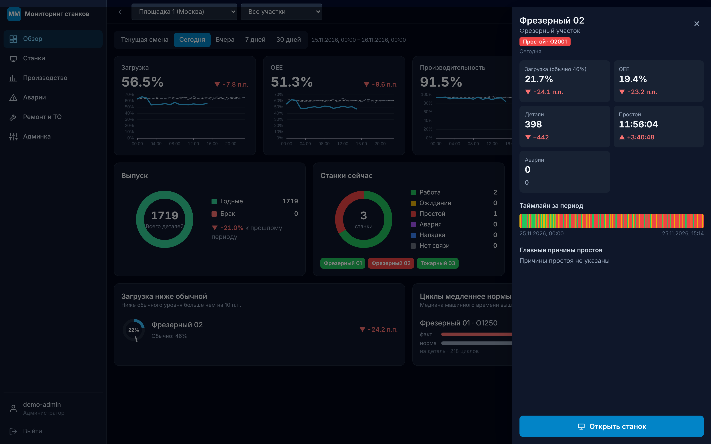
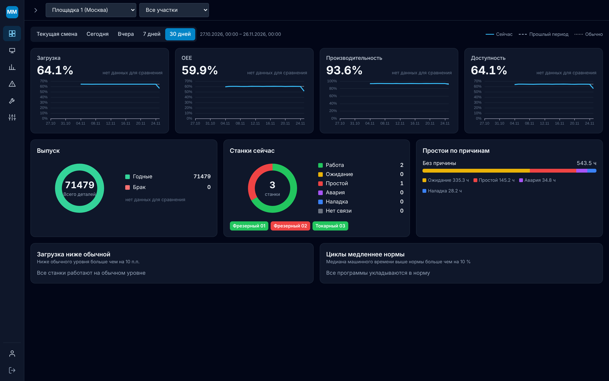

# Главный экран-сводка предприятия (`feat/overview-dashboard`, PR #21)

Решения — ADR 0012. Что сделано, как проверено и что стоит подтвердить.

## Что сделано

**Каркас интерфейса**
- Меню слева: Обзор (`/`), Станки (`/machines`), Производство (бывшая «Аналитика», `/analytics`), Аварии,
  Ремонт и ТО, Сервис (только `service`), Админка; внизу — профиль и выход. Пункты — по флагам `me.menu`,
  «Обзор» — при `menu.analytics`.
- Меню сворачивается до иконок (запоминается в браузере); до 768 px — за кнопкой-гамбургером.
- Площадка и участок — вверху экрана, общие для страниц каркаса (обзор, станки, производство).
- «Станки» — плитки ТВ-дашборда тем же компонентом. `/dashboard`, `/dashboard/:areaId`, `/operator/:id`,
  `/m/<код>` — без меню, как раньше.

| Широкий экран, меню свёрнуто | Телефон | Телефон, меню |
|---|---|---|
|  |  |  |

**Обзор (`/`)**
- Периоды: текущая смена, сегодня, вчера, 7 дней, 30 дней — в часовом поясе площадки.
- Карточки «Загрузка», «OEE», «Производительность», «Доступность»: значение, изменение к той же прошедшей
  части прошлого периода в п.п. (рост — зелёный, падение — красный), график: текущий (сплошная), прошлый
  (пунктир), обычный уровень (точки). Шаг — час (смена, сегодня, вчера), день (7, 30 дней).
- Выпуск (кольцо годные / брак, изменение к прошлому периоду), станки сейчас (кольцо и числа по состояниям,
  кнопки станков; живые данные по `/ws/live`), простои по причинам (топ-5, прочие и «без причины» с разбивкой по
  состояниям), «загрузка ниже обычной» (кольцо с отметкой обычного уровня), «циклы медленнее нормы» (полосы
  «факт / норма», разница в секундах и процентах).
- Клик по станку (в «станках сейчас», «ниже обычной», «медленнее нормы») — боковая панель: загрузка с обычным
  уровнем, OEE, детали, простой, аварии с изменениями, мини-таймлайн, главные причины простоя, «Открыть станок».
- Сводка обновляется раз в минуту, живой блок — по WebSocket.

**Сервер** — `GET /api/v1/overview?period=&site_id=&area_id=` (`backend/app/reports/overview.py`)
- Загрузка = RUN / календарное время по `state_intervals`, с часами вне смен и перерывами.
- OEE, производительность, доступность — из сумм компонентов `oee_hourly` (`oee.calc.ratios`, формулы не
  менялись); час без смены — `null` (пропуск на графике).
- Все отрезки (текущие шаги, прошлый период, 4 недели назад) — одним запросом на источник:
  `timeline.state_seconds`, `timeline.part_totals`, `oee.component_sums`. Простои — `reports.downtime_pareto`;
  циклы — `cycles.summaries` (общая часть `cycles.stats` без гистограмм и разбивок, `stats` строится на ней).
- Пороги — `MM_OVERVIEW_UTILIZATION_DROP_PP` (10) и `MM_OVERVIEW_SLOW_CYCLE_PCT` (10).
- Ответ на демо-стенде: 0,1–0,7 с (30 дней — самый долгий).
- `timeline.state_seconds` для каждого отрезка и станка берёт интервалы, начавшиеся внутри отрезка, и один
  последний, начавшийся до него (интервалы станка не перекрываются — цепочку держит `_store_intervals`), поэтому
  время не растёт с возрастом истории. Замер на синтетике (PostgreSQL 16 + TimescaleDB, 10 станков, интервал
  каждые 4 минуты, отрезки — как строит сводка; медиана из трёх; результаты запросов совпадают):

  | История | Строк `state_intervals` | Период | Отрезков | Прежний запрос | Новый |
  |---|---|---|---|---|---|
  | 21 день | 76 тыс. | Сегодня | 137 | 0,34 с | 0,02 с |
  | 21 день | 76 тыс. | 30 дней | 65 | 0,09 с | 0,03 с |
  | 1 год | 1,31 млн | Сегодня | 137 | 13,2 с | 0,03 с |
  | 1 год | 1,31 млн | 30 дней | 65 | 6,2 с | 0,10 с |

**Симулятор**
- `backfill_hours` до 672 (28 дней); последние `backfill_detail_hours` (72) — с шагом 5 с, старше —
  `backfill_long_step_s` не мельче 30 с. Механизм прежний: маркер `history-replayed.json`, путь буфер → брокер →
  ingest, только профиль `dev`.
- `recent_profile` / `recent_hours`: с момента «N часов до первого запуска» станок идёт по другому сценарию;
  момент хранится в `recent-profile.json` рядом с буфером (перезапуск его не сдвигает), счётчик деталей
  продолжается без скачка. По умолчанию выключен — сценарии golden-тестов и их эталоны не менялись.
- Новые сценарии: `milling_slow` (O1250 — 100 с при норме 85 с, норма — в демо-данных миграций),
  `frequent_stops_heavy`, `program_change_stops`. В `edge/config.sim.*.yaml`: sim01 — медленная O1250, sim02 и
  sim05 — больше простоев, последние 12 часов.

## Замер `make up` с нуля

Облачная машина: 4 ядра, 15 ГБ памяти; образы собраны заранее (сборка зависит от сети и в замер не входит).
От `up` на чистых томах до момента, когда `worker` догнал текущее время (отметки пересчёта — в пределах минуты):

| История | Время | Строк `telemetry` | Размер базы |
|---|---|---|---|
| 28 дней (672 ч) | 10 мин 16 с | 697 тыс. | 306 МБ |
| **21 день (504 ч)** — оставлено в `edge/config.sim.*.yaml` | **8 мин 42 с** | 576 тыс. | 249 МБ |

28 дней не уложились в 10 минут — по условию задачи число дней уменьшено до 21. Узкое место — приём (`ingest`,
около 1000 сообщений/с) и затем `worker` (≈ 3 суток истории в минуту на 6 станков); симуляторы досылают историю
за 2 минуты. Пока история догоняется, обзор показывает неполные цифры (ноль загрузки за ещё не построенные часы).

На демо (21 день) сегодня: площадка 1 — «ниже обычной» Фрезерный 02 (−24 п.п.), «медленнее нормы» Фрезерный 01 ·
O1250 (+15 с, +17,6 %); площадка 2 — «ниже обычной» Фрезерный 05. «30 дней» — «нет данных для сравнения» во всех
карточках и выпуске, обычный уровень — только для дней, у которых есть хотя бы одна такая же неделя истории.

## Проверка

- `make lint`, `make test` — зелёные: backend 120 тестов (+5), edge 43 (+3), frontend — проверка типов.
- `backend/tests/test_overview.py`: загрузка с RUN вне смен (смена 8 ч, работа 12 ч → 50 % загрузки, 100 %
  доступности, OEE вне смены — пропуск), изменение к прошлому периоду, обычный уровень по тем же часам 4 недель,
  «нет данных для сравнения» для 30 дней, пороги «ниже обычной» и «медленнее нормы» (срабатывают на 10, не
  срабатывают на 20 п.п. / 30 %); `state_seconds` даёт то же, что полный просмотр истории (открытый интервал,
  интервал длиннее отрезка, отрезок до начала истории и после её конца).
- `test_tenancy.py`: маршрут в тесте изоляции (чужая площадка — 404, свой администратор получает данные); мастер
  видит в сводке только свой участок, чужая площадка — 404.
- Edge: продолжение счётчика при смене профиля, ограничения конфига (672 ч, шаг ≥ 30 с), момент смены профиля не
  сдвигается при перезапуске.
- **Вручную (контейнер `web`, Playwright):**

  | Кто | Открыл | Попал | Меню |
  |---|---|---|---|
  | токен киоска станка | `/?token=dev_demo-kiosk-sim02` | `/operator/2` (как раньше) | нет |
  | токен ТВ участка | `/?token=dev_demo-display-area1` | `/dashboard/1` (как раньше) | нет |
  | `demo-operator` | `/` | `/dashboard` (как раньше) | нет |
  | `demo-master`, `demo-engineer`, `demo-service` | `/` | обзор | есть |

## Решения, которые стоит подтвердить

1. **Сводка — по одной площадке**, без режима «все площадки»: границы суток и смен у площадок в разных часовых
   поясах разные. Выбор площадки — вверху экрана, как в «Производстве».
2. **Прошлый период — та же прошедшая часть**: сегодня до 14:00 сравнивается со вчера до 14:00; текущая смена —
   с прошлым экземпляром той же смены (дневная с дневной). 7 и 30 дней заканчиваются сегодняшним днём.
3. **Обычный уровень — по суммам** (RUN и календарное время, компоненты OEE за 4 такие же недели), а не
   среднее процентов. Прошлый период сравнивается, только если целиком лежит в истории станков; иначе — «нет
   данных для сравнения».
4. **«Простой» в боковой панели** — IDLE + STOP + ALARM + SETUP (без OFFLINE). «Без причины» в простоях
   показывает все состояния, кроме RUN, с разбивкой (включая «нет связи»).
5. **«Медленнее нормы» — медиана машинного времени на деталь** против нормы на деталь (норма — действующая на
   конец периода).
6. **«Открыть станок» ведёт на `/m/<код>`** — страница паспорта сама выбирает экран по роли (сервису — карточка,
   мастеру и технологу — страница станка). Код паспорта отдаётся только в сводке, ролям с аналитикой.
7. **Демо: 21 день вместо 28** (замер выше). Шаг 30 с огрубляет циклы короче минуты: в старой части истории
   медианы машинного времени искажены, и «медленнее нормы» за 30 дней на демо показывает ложную программу
   (Токарный 06 · O5005, +58 %). Загрузка и OEE от шага не зависят; за смену, сегодня, вчера и 7 дней список
   верный (последние 72 часа — с шагом 5 с). Если ложная строка мешает показу — увеличить
   `backfill_detail_hours` (дольше `make up`) или принять.
8. **«Аналитика» переименована в «Производство»**, `/analytics` остался прежним. Оператор по `/` по-прежнему
   попадает на ТВ-дашборд без меню, а не в «Станки».
9. Пороги 10 п.п. и 10 % — настройки сервера (`MM_OVERVIEW_*`), не площадки.
